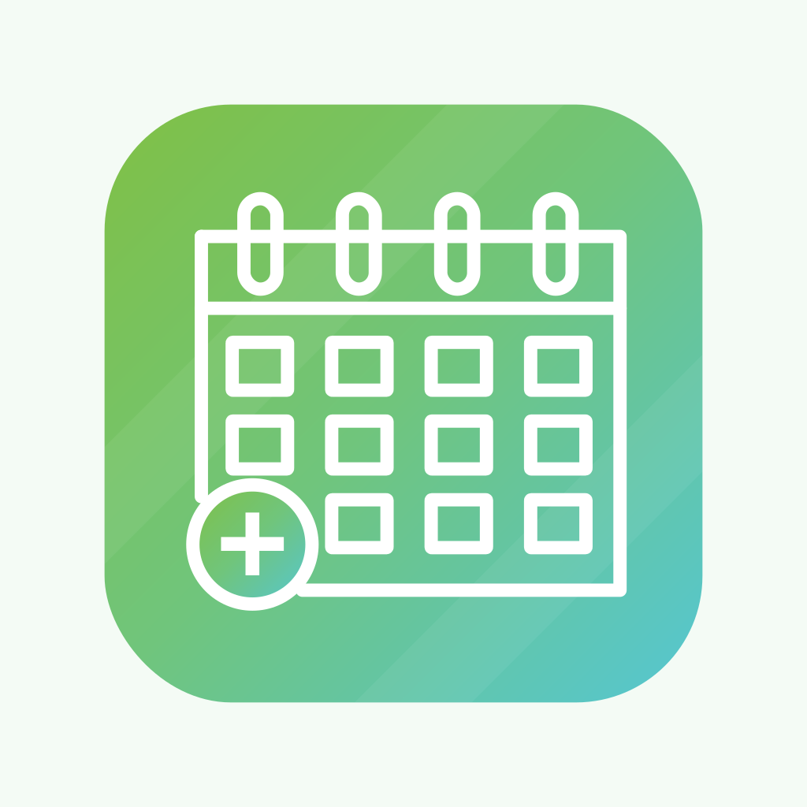
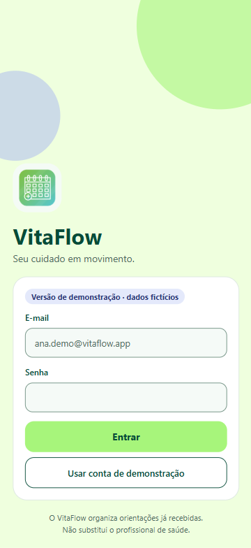
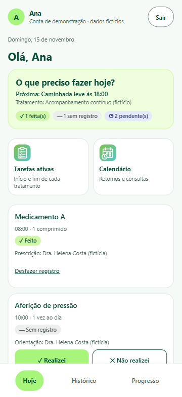
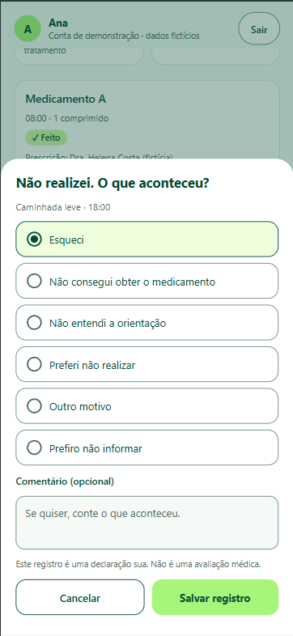
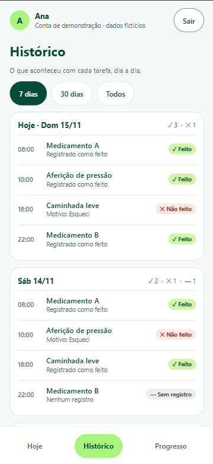
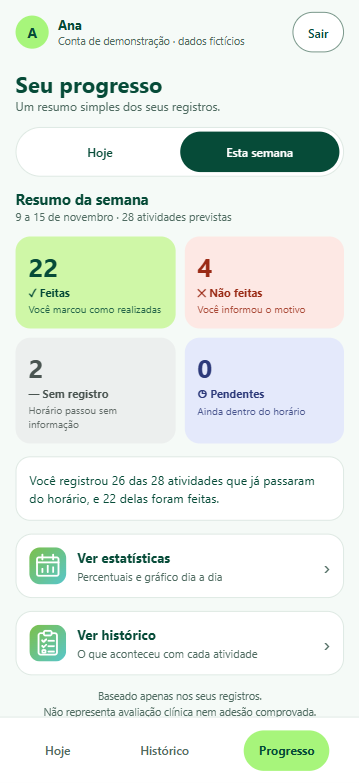

<p align="center">
  
</p>

# VitaFlow

**Seu cuidado em movimento.**

## Sobre o projeto

Este projeto está sendo desenvolvido como parte do FMU Tech Inovação, alinhado ao Objetivo de Desenvolvimento Sustentável (ODS) 3 — Saúde e Bem-Estar, com o propósito de contribuir para a continuidade dos tratamentos médicos e incentivar a adoção de hábitos saudáveis.

A proposta surgiu da percepção de uma dificuldade na área da saúde: nem sempre receber uma prescrição médica significa conseguir segui-la adequadamente no dia a dia. Esquecimentos, dificuldades de acesso a medicamentos e obstáculos na organização da rotina podem comprometer a continuidade de um tratamento.

Pensando nisso, buscamos desenvolver uma aplicação que aproxime as orientações recebidas durante o atendimento médico da realidade cotidiana do paciente. A plataforma organiza prescrições em tarefas, acompanha sua realização, registra dificuldades e mostra o progresso ao longo do tratamento.

Nossa proposta é construir uma solução simples, acessível e intuitiva, mas com uma estrutura que possibilite sua futura integração aos sistemas de instituições de saúde, tanto públicas quanto privadas.

Mais do que lembrar o paciente de tomar um medicamento, queremos oferecer uma ferramenta que facilite a organização do cuidado e ajude a transformar orientações de saúde em ações possíveis no cotidiano.

O VitaFlow não substitui o profissional de saúde, não realiza diagnósticos e não toma decisões clínicas. Sua função é apoiar o paciente na execução e no acompanhamento das orientações recebidas.

## Integrantes

| Nome | RA | Contribuição no Checkpoint 2 |
|---|---|---|
| Ricardo Soares Hernandes | 3172147 | Base do aplicativo, telas de Login, Hoje e Progresso, integração com a API e documentação |
| Lucas Ribeiro Salomão | 3214852 | Regra de cálculo de status, registro de tarefas na API e modal de motivo |
| Bruna Borges Souza | 3200750 | Modelagem do banco de dados, dados de demonstração e tela de Histórico |
| Eziel Cavalcante | 3028492 | Estrutura da API, gerador de tarefas e rotas de consulta |

## Fonte de dados

Os dados utilizados no projeto são simulações de dados públicos, pois dados de saúde são sensíveis e protegidos por lei, especialmente pela Lei Geral de Proteção de Dados (LGPD). Essa abordagem já foi discutida com o professor.

Usuários, tratamentos, prescrições, tarefas e registros são fictícios. O protótipo não utiliza prontuários nem informações reais de pacientes. A paciente de demonstração (Ana) e a médica (Dra. Helena Costa) são personagens fictícias.

As fontes públicas identificadas como referência para o projeto são:

- **PNAUM:** acesso, utilização e promoção do uso racional de medicamentos.
- **Pesquisa Nacional de Saúde (PNS 2019):** doenças crônicas, utilização de serviços e acesso a medicamentos.
- **Vigitel:** fatores de risco e proteção para doenças crônicas.
- **DATASUS e OpenDataSUS:** estatísticas e conjuntos de dados públicos de saúde.
- **INCA:** informações epidemiológicas e estimativas sobre câncer.
- **Anvisa:** informações oficiais sobre medicamentos, incluindo bulas.
- **Ministério da Saúde:** Guia Alimentar para a População Brasileira, Guia de Atividade Física para a População Brasileira e materiais sobre doenças crônicas e assistência farmacêutica.

## Recursos, tecnologias e linguagem

O VitaFlow é um aplicativo mobile com back-end próprio e banco de dados relacional. A linguagem principal é **JavaScript**, usada tanto no aplicativo quanto no servidor.

| Camada | Tecnologia | Finalidade |
|---|---|---|
| Aplicativo | React Native + Expo | Desenvolvimento da interface mobile |
| API | Node.js + Express | API REST e regras de negócio |
| Acesso aos dados | Prisma | Comunicação entre o back-end e o banco |
| Banco de dados | PostgreSQL (plano original) e SQLite (uso atual) | Armazenamento persistente das informações |

O plano original do projeto é utilizar PostgreSQL. Neste momento, o SQLite é utilizado apenas para facilitar o desenvolvimento, por se tratar de um projeto pequeno. Como o acesso aos dados é feito pelo Prisma, a solução mantém compatibilidade com o PostgreSQL.

**Fluxo da arquitetura:** Aplicativo React Native + Expo → API REST em Node.js + Express → Prisma → SQLite (uso atual) ou PostgreSQL (plano original).

**Ferramentas de apoio:** Visual Studio Code, Git, GitHub, Figma, Expo Go, Postman ou Insomnia e ferramentas de gerenciamento de banco de dados.

### Estrutura do repositório

```text
VitaFlow/
├── api/        API REST, regras de negócio e banco de dados
├── mobile/     Aplicativo em React Native + Expo
├── docs/       Capturas de tela e materiais de apoio
└── README.md
```

## Funcionalidades do protótipo

- **Login de demonstração:** acesso com uma conta fictícia já cadastrada. O aplicativo identifica em todas as telas que é uma demonstração, mostra quem está conectado e permite sair. Não há autenticação real nesta versão.
- **Hoje:** lista as tarefas do dia geradas a partir de uma prescrição simulada, em ordem de horário, com a próxima atividade em destaque.
- **Registro de tarefas:** cada tarefa pode ser marcada como realizada ou não realizada. Quando não é realizada, o paciente escolhe o motivo (incluindo "Prefiro não informar") e pode deixar um comentário. O aplicativo nunca presume o motivo, e o registro pode ser desfeito.
- **Origem de cada orientação:** cada tarefa mostra se veio de prescrição ou de orientação profissional, com o nome do profissional registrado. A atividade física recomendada aparece com selo e conteúdo educativo.
- **Histórico:** mostra o que aconteceu com cada tarefa, dia a dia, com filtros de 7 dias, 30 dias e todo o período.
- **Progresso:** apresenta totais, duas taxas e um gráfico de registros, com visões de dia e de semana.
- **Persistência:** os registros são salvos em banco de dados e continuam disponíveis ao reabrir o aplicativo.
- **Recursos planejados já posicionados na interface:** a visão de mês e o relatório de medicações (no Progresso) e os atalhos de tarefas ativas e calendário (na tela Hoje) aparecem onde serão usados. Ao tocar neles, o aplicativo informa que o recurso estará disponível em breve. Eles ainda não funcionam e estão listados em "Próximos passos".

### Regras que orientam o aplicativo

- **Sem registro não é falha.** Se o paciente não informa nada, a tarefa aparece como "Sem registro", e nunca como "Não feito". Uma tarefa só passa a "Sem registro" uma hora depois do horário previsto.
- **Duas taxas transparentes.** O Progresso mostra "Atividades registradas" (de quantas atividades que já passaram do horário o paciente informou o resultado) e "Atividades realizadas" (entre as registradas, quantas foram feitas), sempre com os números de base. As tarefas pendentes ficam fora das duas contas, e o aplicativo não apresenta uma taxa única de adesão.
- **O aplicativo não decide nada clínico.** Medicamentos, aferições e exercícios vêm da prescrição simulada. O VitaFlow apenas organiza e registra.
- **Status com símbolo e texto.** Nenhuma informação depende apenas de cor.

## Como executar

**Pré-requisitos:** Node.js 18 ou superior e Git.

### 1. Clonar o repositório

```bash
git clone https://github.com/ciRodra/VitaFlow.git
cd VitaFlow
```

### 2. Iniciar a API

```bash
cd api
cp .env.example .env        # no Windows (PowerShell): copy .env.example .env
npm install
npx prisma db push
npm run seed
npm run dev
```

- `npx prisma db push` cria o banco SQLite a partir do `prisma/schema.prisma`.
- `npm run seed` cria a paciente de demonstração, a prescrição simulada e uma semana de tarefas e registros. Como as datas são calculadas a partir do dia atual, rode o seed de novo sempre que for apresentar.

A API fica disponível em `http://localhost:3333`. Para conferir, abra `http://localhost:3333/health` no navegador.

| Rota | Função |
|---|---|
| `POST /auth/login` | Login da conta de demonstração |
| `GET /tasks` | Tarefas de hoje, com status calculado |
| `PUT /tasks/:id/record` | Registra uma tarefa como feita ou não feita (com motivo) |
| `DELETE /tasks/:id/record` | Desfaz um registro |
| `GET /history?days=7` | Tarefas agrupadas por dia |
| `GET /progress?days=7` | Totais, as duas taxas e o resumo diário |

### 3. Iniciar o aplicativo

Em outro terminal:

```bash
cd mobile
npm install
npx expo start --web
```

O aplicativo abre no navegador em `http://localhost:8081`. Na tela de login, use o botão **Usar conta de demonstração**.

Para testar no celular com o Expo Go, troque `localhost` pelo IP do computador em `mobile/src/services/api.js`. Se a API não estiver rodando, o aplicativo avisa e mostra dados de demonstração, sem salvar registros.

## Telas

| Login | Hoje | Motivo | Histórico | Progresso |
|---|---|---|---|---|
|  |  |  |  |  |

## Identidade visual

O nome **VitaFlow** une "vita" (vida, vitalidade e saúde) e "flow" (fluxo, movimento e continuidade). A identidade busca transmitir saúde, organização, simplicidade, confiança, acessibilidade e humanização, sem a complexidade visual de um sistema hospitalar tradicional.

### Paleta de referência

| Uso | Cor |
|---|---|
| Verde principal | `#A7F57B` |
| Verde-claro | `#CFF7A7` |
| Fundo verde muito suave | `#EFFFDE` |
| Azul/lilás complementar | `#A8B6F0` |
| Fundo neutro | `#F5FAF7` |
| Verde-escuro para textos | aproximadamente `#064B38` |

Esses códigos são referências iniciais e poderão ser ajustados para garantir contraste, legibilidade e acessibilidade.

### Diretrizes visuais

- **Tipografia:** Poppins, fonte sem serifa, geométrica, moderna e amigável.
- **Elementos gráficos:** círculos sobrepostos, grade quadriculada, cantos arredondados, cruzes médicas arredondadas e superfícies claras.
- **Símbolo:** quadrado de cantos arredondados, em tons de verde, com um calendário e um sinal de adição, representando uma agenda de saúde.
- **Interface:** composição minimalista, cartões arredondados, ícones simples, linguagem clara e status que não dependam apenas de cores.

## Andamento do projeto

### Checkpoint 1

O VitaFlow estava na fase de planejamento, definição da identidade visual e preparação para o desenvolvimento do MVP. O desenvolvimento do aplicativo ainda não havia sido iniciado.

### Checkpoint 2

Desde o Checkpoint 1, o projeto passou do planejamento para um protótipo funcional. O grupo construiu o aplicativo, a API e o banco de dados, e ligou as três partes em um fluxo completo: a prescrição simulada gera as tarefas do dia, o paciente registra o que fez, os registros são salvos no banco e aparecem no Histórico e no Progresso.

Nesta etapa, o grupo também definiu as regras centrais do produto, como a diferença entre "Sem registro" e "Não feito" e o cálculo das duas taxas de progresso, além de padronizar o contrato de dados entre o aplicativo e a API.

### Próximos passos

- Visão de mês no gráfico de Progresso.
- Histórico como uma opção dentro do Progresso.
- Aba para acompanhar todas as tarefas ativas do paciente, com data de início e de fim.
- Calendário com retornos e consultas futuras.
- Relatório com todas as datas e horários das medicações.
- Metas de hábitos criadas pelo próprio paciente.
- Notificações e lembretes.
- Integração com sistemas de instituições de saúde.
